# SecureText Diagrams

Each diagram is given as Mermaid source (renders on GitHub, VS Code with a Mermaid extension, or https://mermaid.live) and as a pre-rendered PNG in `docs/diagrams/`. The `.mmd` files in that folder are the single source.

## System architecture

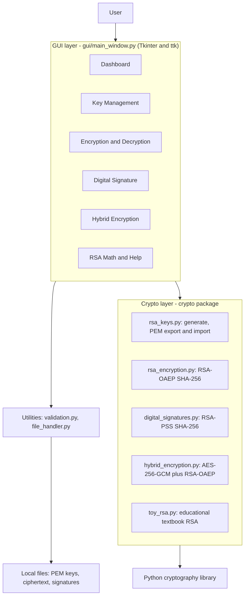

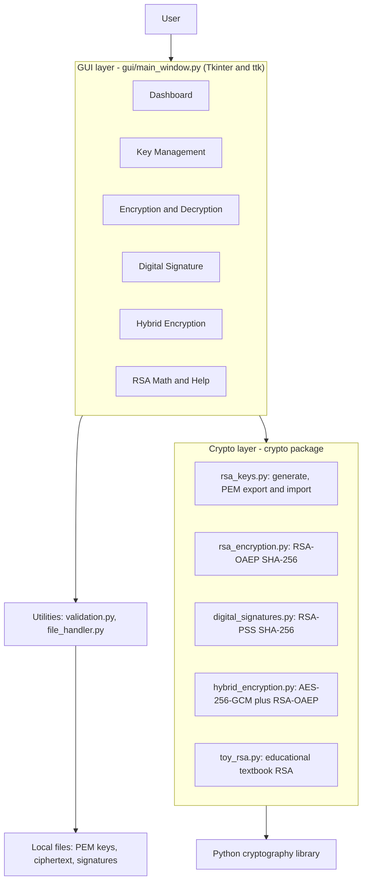

## Use-case diagram

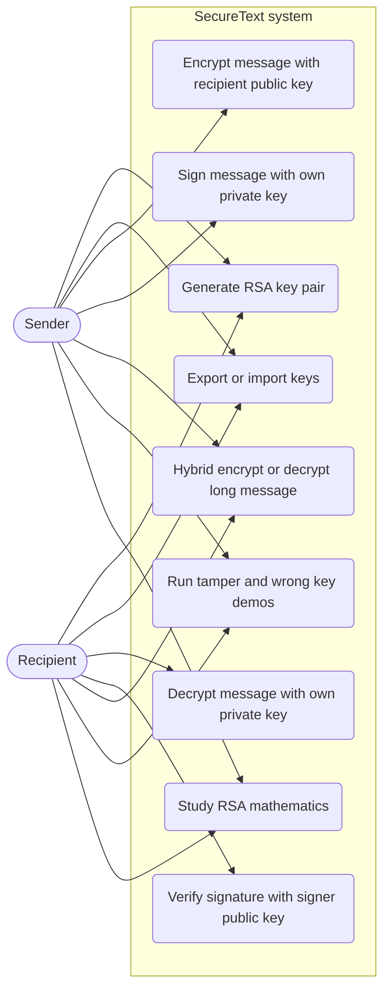

## Data-flow diagram (level 1)

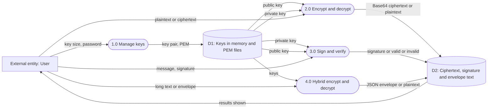

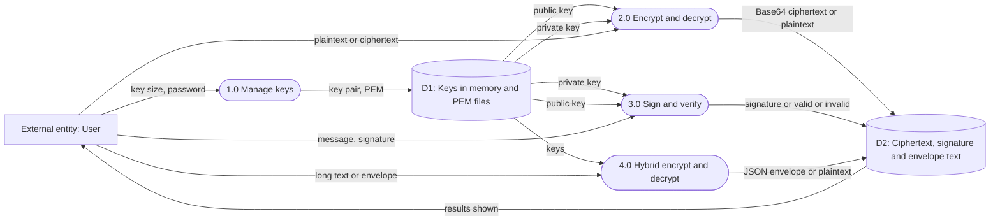

## Application flowchart

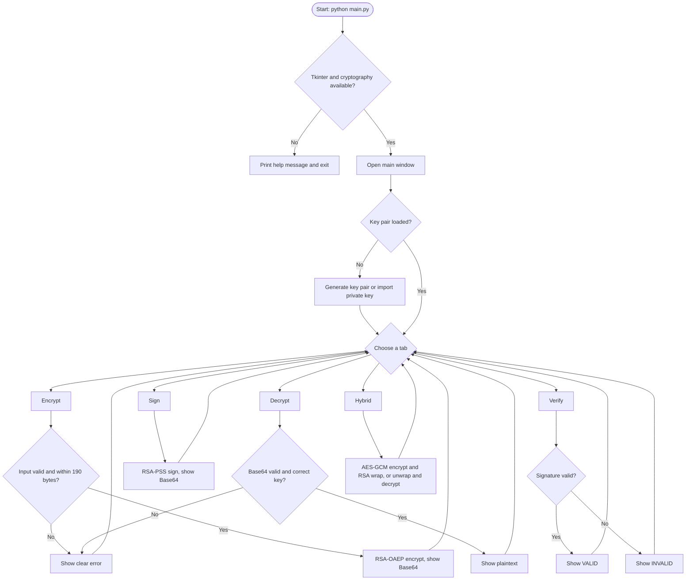

## RSA key-generation process

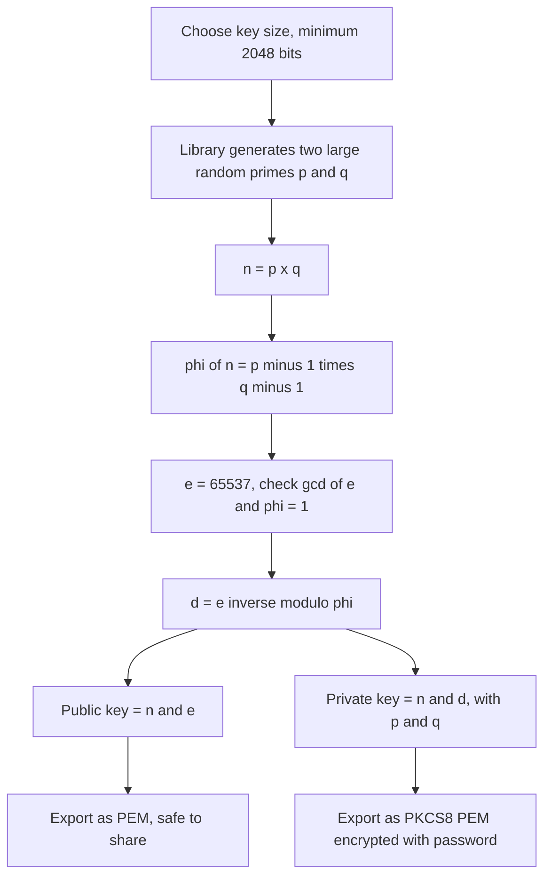

## RSA-OAEP encryption and decryption sequence

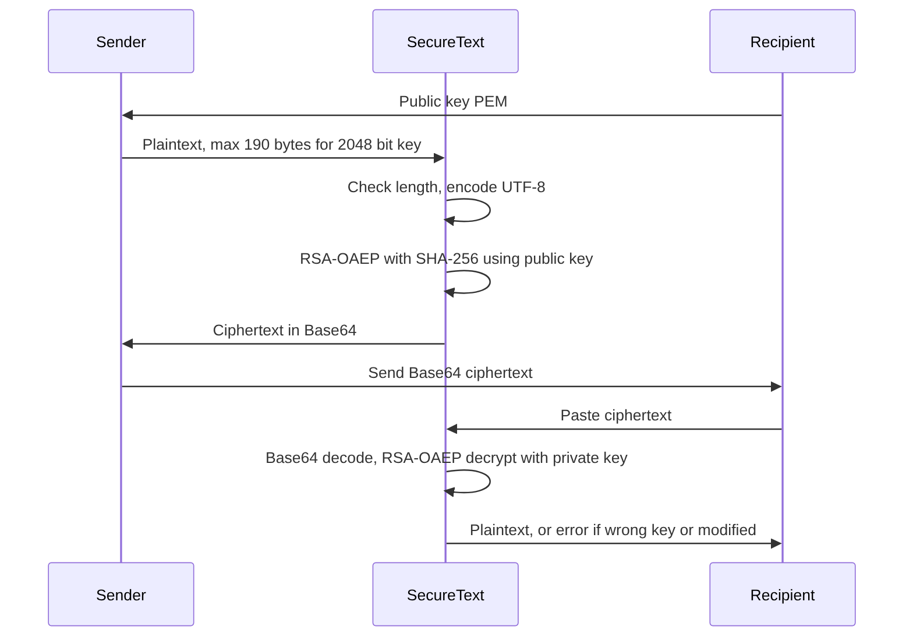

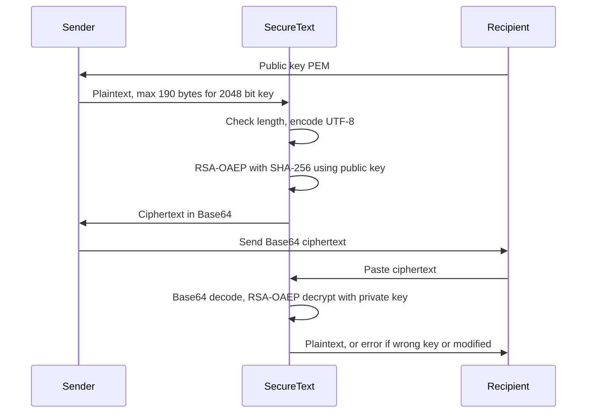

## RSA-PSS signature sequence

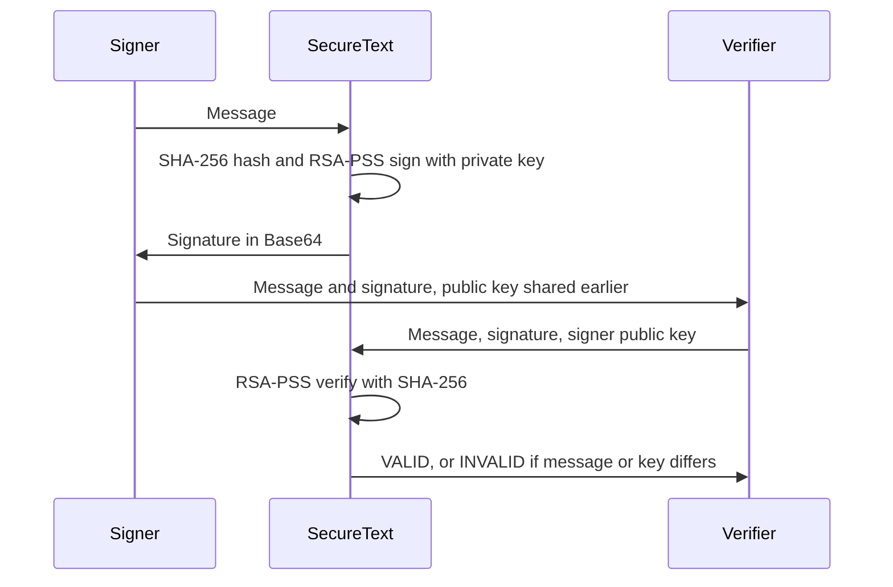

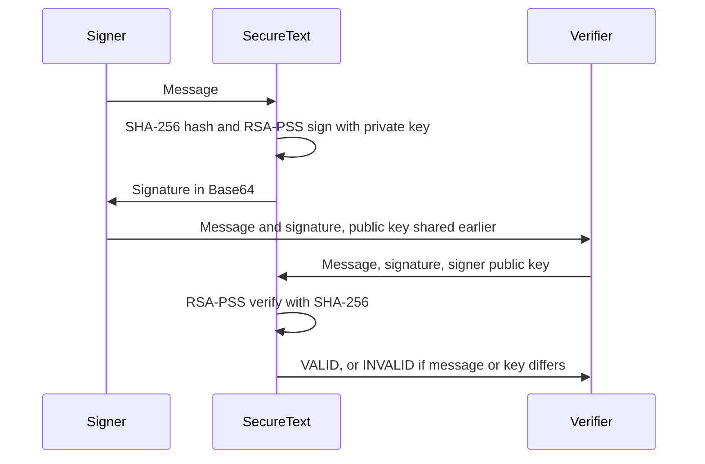

## Hybrid encryption workflow

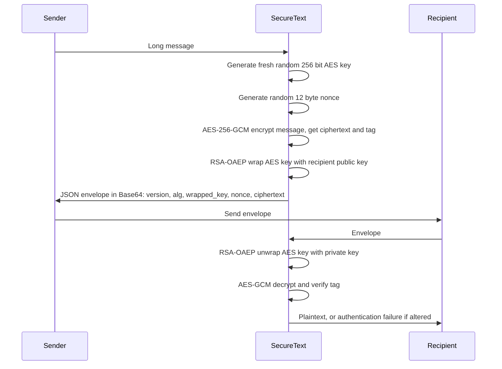

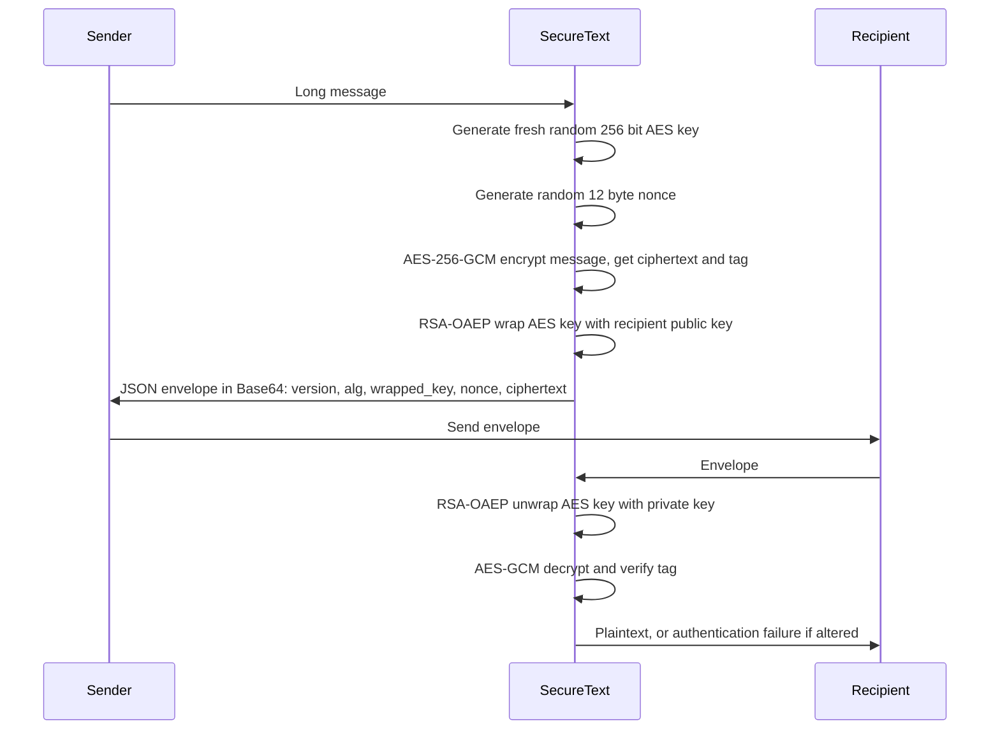
